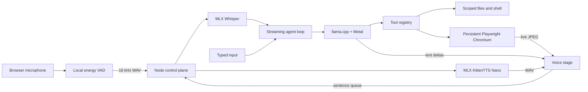

# Architecture

## Turn lifecycle

1. Browser audio is monitored locally. After 220 ms above the speech threshold, any active response and audio are cancelled (barge-in).
2. After 850 ms of silence, the collected audio is downsampled to mono 16 kHz WAV and sent to MLX Whisper.
3. The transcript enters an OpenAI-compatible streaming chat-completions loop. Tool calls are assembled from deltas, executed, and returned to the model.
4. Assistant text is displayed immediately. Complete sentences are sent to KittenTTS while the LLM continues generating. Fetches are queued before ordered playback.
5. Playwright uses a persistent profile. The agent receives a compact page snapshot with stable element references, while the human sees periodic screenshots.

## Memory profile for an 8 GB Mac

The compact profile deliberately uses a 4-bit 4B LLM (about 2.5 GB of weights), 4-bit Whisper Tiny English (about 26 MB), and KittenTTS Nano FP16 (about 62 MB). It keeps the LLM context at 4,096, one inference slot, smaller batches, and Q8 KV cache. macOS, Chromium, runtime buffers, and the model frameworks still share unified memory; close memory-heavy applications if pressure rises.

The demo that inspired this project used a Qwen 35B-A3B model and Breeze-TTS-2 on a 12 GB NVIDIA GPU. Those are not drop-in choices for an 8 GB Mac. This project preserves the cascade and interaction design while selecting practical Apple-native runtimes.

## Automatic 48 GB profile

The main branch retains an automatic full profile for larger Macs. This branch's `.env.example` explicitly selects compact inference so a clone on an 8 GB machine cannot accidentally request the 22 GB model.
