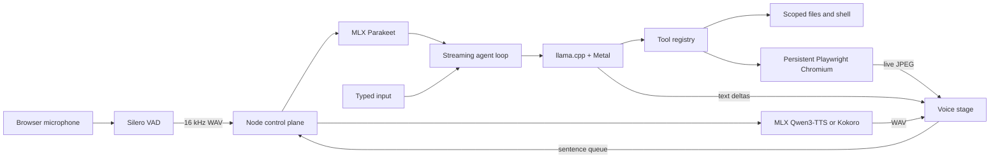

# Architecture

## Turn lifecycle

1. Browser audio is monitored locally. After 220 ms above the speech threshold, any active response and audio are cancelled (barge-in).
2. After 850 ms of silence, the collected audio is downsampled to mono 16 kHz WAV and sent to MLX Parakeet.
3. The transcript enters an OpenAI-compatible streaming chat-completions loop. Tool calls are assembled from deltas, executed, and returned to the model.
4. Assistant text is displayed immediately. Complete sentences are sent to the configured TTS provider while the LLM continues generating. Qwen3-TTS is the default; Kokoro remains selectable. Fetches are queued before ordered playback.
5. Playwright uses a persistent profile. The agent receives a compact page snapshot with stable element references, while the human sees periodic screenshots.

## Memory profile

The default profile uses `empero-ai/Qwen3.8-9B-Distill-GGUF:Q4_K_M`, Parakeet TDT 0.6B, and Qwen3-TTS 1.7B. The LLM runs with a 64K context and one inference slot. macOS, Chromium, runtime buffers, and the model frameworks still share unified memory; close memory-heavy applications if pressure rises.

The demo that inspired this project used a larger Qwen model and Breeze-TTS-2 on a 12 GB NVIDIA GPU. This project preserves the cascade and interaction design while selecting practical Apple-native runtimes.

## Full profile

`scripts/start-models.sh` uses `empero-ai/Qwen3.8-9B-Distill-GGUF:Q4_K_M` with a 64K context, conservative decode batches, and Metal offload. Parakeet remains the STT model and Qwen3-TTS is the default voice. CustomVoice is pinned to Ryan with explicit low-variance sampling and a calm agent-style instruction.
