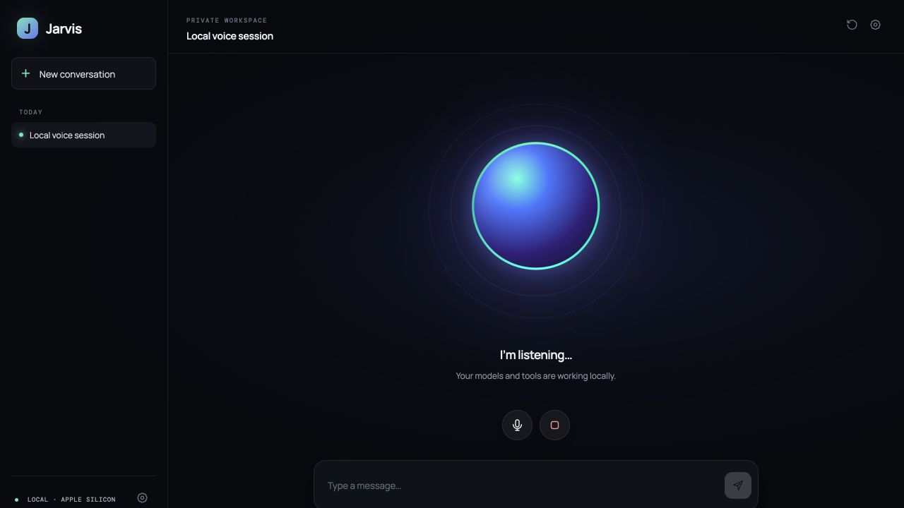

# Jarvis — local voice agent for Apple silicon

Jarvis is a near-real-time, voice-first agent that runs on an Apple silicon Mac. It listens hands-free, streams a local model, speaks by sentence, supports interruption, calls tools, and operates a persistent browser you can watch inside the UI.



## What is included

- Hands-free microphone capture with local turn detection, echo-cancellation request, and barge-in
- MLX Whisper speech-to-text through an OpenAI-compatible API
- Qwen3 4B Q4_K_M through llama.cpp and Metal
- Kokoro 82M 4-bit speech through MLX-Audio, with sentence-level generation/playback overlap
- Streaming OpenAI-compatible tool calls
- Persistent Playwright Chromium with snapshots, click/type tools, optional domain allowlist, and live screenshots
- Workspace-scoped file tools, calculator, time, and a guarded local shell
- Audio-reactive orb, compact tool activity cards, browser panel, typed fallback, and runtime inspector

## Why these models

The [Pithagoras voice demo](https://www.youtube.com/watch?v=xbedfuqYQYA) used Silero V5, Whisper.cpp, Qwen 35B-A3B through llama.cpp, and Breeze-TTS-2/audio.cpp on an RTX 3060 with 12 GB VRAM. That exact combination is CUDA-focused and is too large for an 8 GB unified-memory Mac.

Jarvis uses the same modular cascade with Apple-native substitutions. It detects unified memory at launch and has compact and full profiles:

| Stage | Default | Why on 8 GB Apple silicon |
| --- | --- | --- |
| Turn detection | Local energy/hysteresis VAD | Zero model memory and immediate barge-in |
| STT | `mlx-community/whisper-small-mlx-q4` | Multilingual, roughly 197 MB |
| LLM | `Qwen/Qwen3-4B-GGUF:Q4_K_M` | Strong tool calling at roughly 2.5 GB |
| TTS | `mlx-community/Kokoro-82M-4bit` | Natural voice, small, fast, Apache-licensed weights |
| Browser | Playwright Chromium | Persistent profile and deterministic controls |

On a **32–48 GB Mac**, the full profile automatically switches the brain to the same family as the demo—`Qwen3.6-35B-A3B` UD-Q4_K_M (about 22.1 GB)—with a 32K context, and uses Whisper Large-v3 Turbo FP16. Kokoro remains the voice because its small footprint and low first-audio latency matter more to conversational flow than a much larger speech model. On an **8–16 GB Mac**, the compact profile in the table is selected.

All adapters are configured in `.env`; hosted OpenAI-compatible LLM/STT/TTS endpoints also work.

## Quick start

Requirements: Apple silicon, macOS, Homebrew, Node.js 20+, and at least 7 GB free disk for the compact profile or 32 GB for the full profile.

```bash
git clone https://github.com/pianistprogrammer/jarvis.git
cd jarvis
npm run setup:mac
```

For the simplest launch, start the models and production app together:

```bash
npm run launch
```

Or run them separately while developing:

```bash
npm run models:start
# in another terminal
npm run dev
```

Open [http://localhost:5173](http://localhost:5173), allow microphone access, and speak. The first model use downloads weights and will be slower. On the 48 GB full profile, allow roughly 25 GB of downloads. The launcher waits for both services to report healthy and points to logs if either exits. Production mode is `npm run build && npm start`, then open port 4100.

## Browser use

Ask: “Open Hacker News and summarize the first three stories.” The agent launches a persistent Chromium profile, reads the page, and the browser panel appears automatically. Use `BROWSER_HEADLESS=false` if you also want a native Chromium window for manual sign-in.

For safer navigation, edit `.env`:

```dotenv
BROWSER_ALLOWLIST=github.com,*.wikipedia.org,news.ycombinator.com
```

Install browser binaries separately after a dependency update with `npm run browser:install`.

## Tuning an 8 GB machine

- Keep `--ctx-size 4096`, `--parallel 1`, and the Q4 model in `scripts/start-models.sh`.
- Close Chrome, Docker Desktop, and other memory-heavy apps before starting all models.
- Switch STT to `mlx-community/whisper-base-mlx-4bit` if Small causes pressure.
- Use typed input while testing the LLM independently; the UI remains fully usable with the mic muted.
- If you already run LM Studio or Ollama, point `LLM_BASE_URL` and `LLM_MODEL` at its OpenAI-compatible endpoint and start only MLX-Audio.

Force a profile in `.env` when automatic selection is not what you want:

```dotenv
MODEL_PROFILE=full
# MODEL_PROFILE=compact
```

The repository’s automated checks do not download weights or exercise microphone hardware. See [ARCHITECTURE.md](ARCHITECTURE.md) for the pipeline and [SECURITY.md](SECURITY.md) before signing the browser into accounts.

After setup, `npm run doctor` checks the machine and service health. `npm test`, `npm run check`, `npm run lint`, and `npm run build` verify the tool/browser layer and both TypeScript applications.

## Configuration

Copy `.env.example` to `.env`. The important options are `LLM_BASE_URL`, `LLM_MODEL`, `STT_URL`, `STT_MODEL`, `TTS_URL`, `TTS_MODEL`, `TTS_VOICE`, `AGENT_WORKSPACE`, and `BROWSER_ALLOWLIST`.

## Attribution

The product concept and visual interaction are inspired by [thecodacus/pithagoras](https://github.com/thecodacus/pithagoras) and Codacus’s linked demo. This repository is an original implementation because the reference repository does not currently publish a software license. Jarvis is MIT licensed; model weights and dependencies retain their own licenses.
